# EDA findings (exploration set, 70%, seed 42)

Rows: 590,043 exploration rows; 397,390 market-sale rows = 382,004 market deals (a multi-lot deal counted once); 174,115 with a valid price per sq ft.

## Sale price classes and the market-price distribution
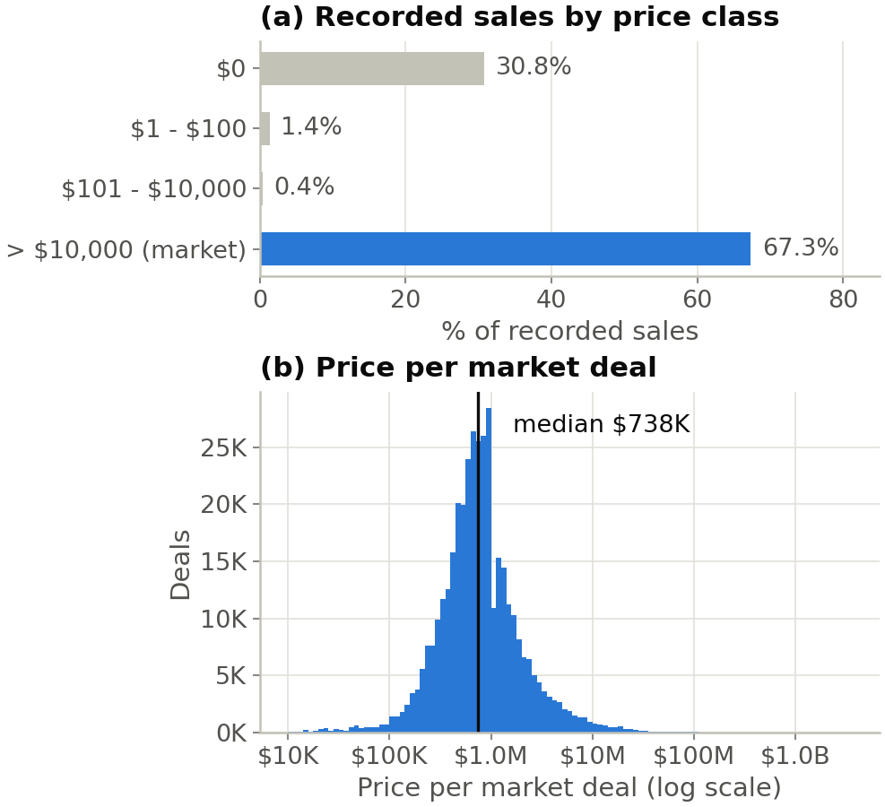

**Takeaway.** 30.8% of recorded sales are $0 and 32.3% are <= $100 (deed transfers, not prices), so price statistics must exclude them. Counting each multi-lot deal once (382,004 market deals), prices have median $738K, IQR $456K-$1.2M and max $2.4B: right-skewed over five orders of magnitude, so we analyse log price and use rank-based alternatives.

## Nominal-transfer share by borough
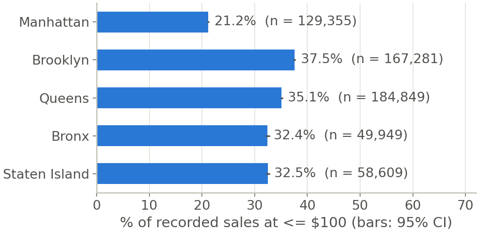

**Takeaway.** Nominal transfers range from 21.2% of recorded sales in Manhattan to 37.5% in Brooklyn (16.4 percentage points apart, well beyond the 2-point threshold): motivates T4 (chi-square test of independence).

## Missing values by column and by building type
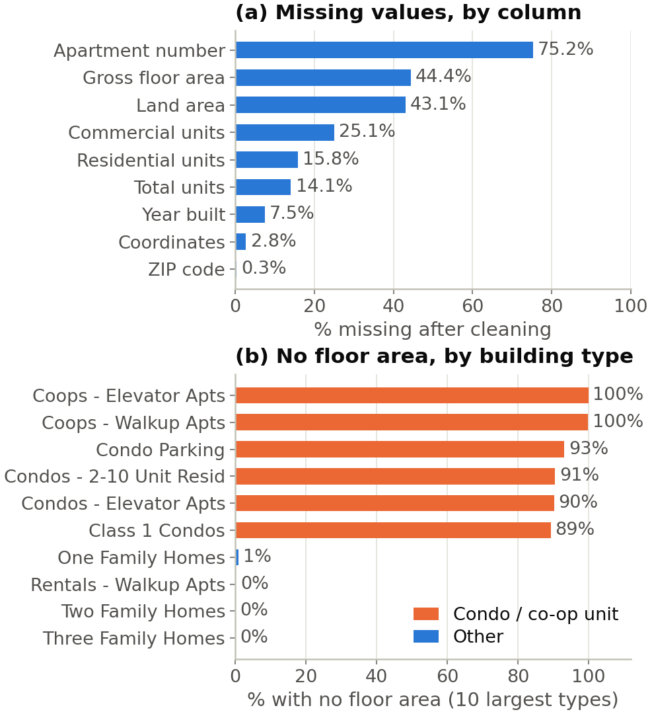

**Takeaway.** Gross floor area is missing for 44.4% of sales, but that is 95% of condo/co-op unit sales vs 5% of other sales: it is missing by design (the area belongs to the building, not the unit), not at random. Per-sq-ft results therefore speak for houses, rental and commercial buildings, not apartments; we do not impute it.

## Heaping in year built
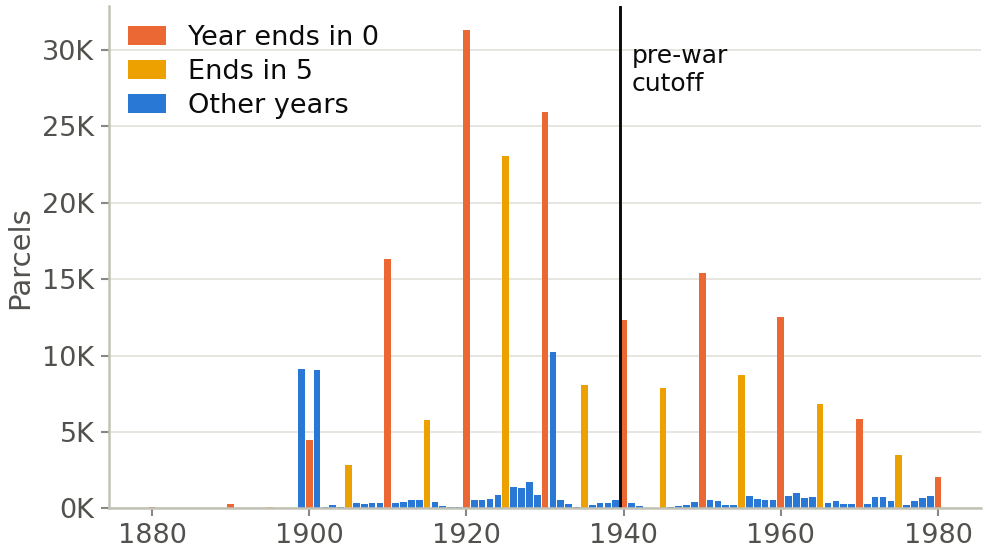

**Takeaway.** 60.8% of parcels have a year built ending in 0 or 5 (20% expected without rounding); 37.9% end in 0. Among pre-1940 parcels it is 73.2%. 1940 itself holds 12,337 parcels vs 540 in 1939, so a building recorded as 1940 may really be pre-war: T1 needs a sensitivity check with the cutoff moved (e.g. drop 1935-1945).

## Price trends by borough
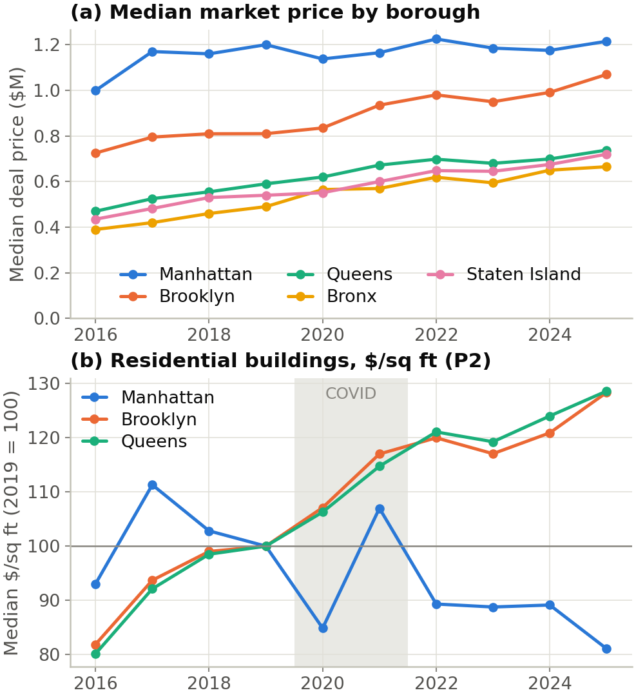

**Takeaway.** Manhattan has the highest median deal price every year ($999K-$1.2M), the obvious answer, but from 2016 to 2025 it rose 22% vs 48-71% in the other boroughs. Indexed to 2019, Manhattan's price per sq ft was 107 in 2021 vs 116 for the Brooklyn-Queens average and 81 vs 128 in 2025 (P2; 1-3 family and rental buildings only, so the type mix is the same every year). Caveat: Manhattan has only 270-567 such sales a year in this set (its market is condos and co-ops, which carry no area), so T2 uses log price of like-for-like apartment sales instead.

## Pre-war vs newer price per sq ft (P1)
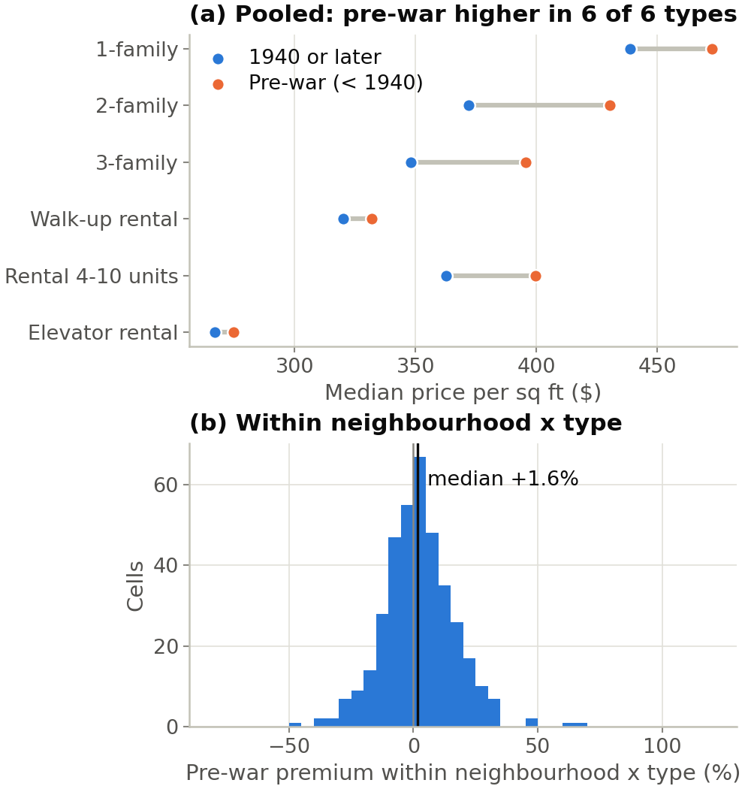

**Takeaway.** Pooled over the city, pre-war residential buildings sell for +6.6% per sq ft (geometric mean) vs newer ones, but within the same neighbourhood and building type the median pre-war premium is +1.6% across 383 cells (57% of cells positive, IQR -6% to +11%). Holding location and type fixed moves the gap from +6.6% to +1.6%, near the 5% 'matters' threshold, so the answer could go either way: P1 is not obvious, and T1 must compare like with like.

## Floor area vs price (1-3 family homes)
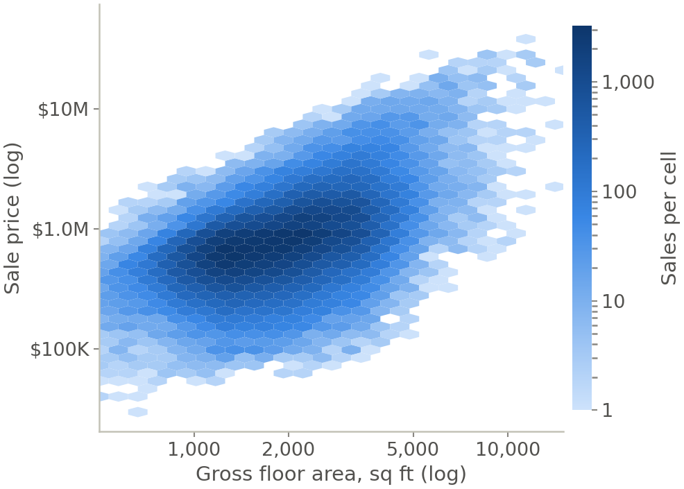

**Takeaway.** Spearman rho = 0.49 between floor area and price for 153,157 1-3 family sales: bigger homes do cost more (the obvious question), but only moderately, since location varies more than size. Price per sq ft falls with size (rho = -0.26), so per-sq-ft comparisons must hold building type (and so size) fixed.

## Monthly sales volume
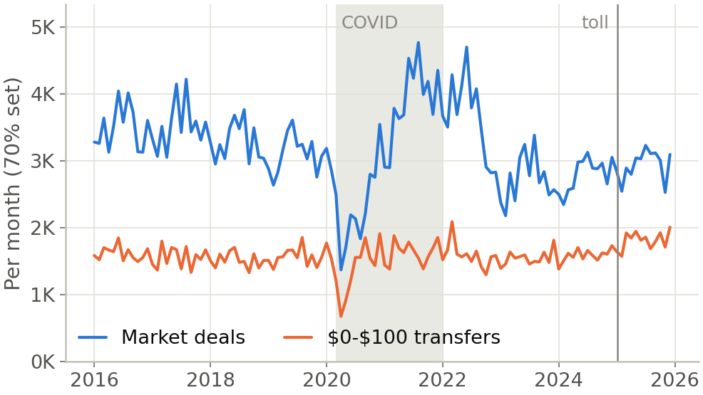

**Takeaway.** Market deals in Apr-Jun 2020 were -48% vs Apr-Jun 2019; the busiest month was 2021-08 (4,763 deals in this 70% set). The COVID period changes which properties sell, a composition effect P2 must keep in mind; transfers track market deals month to month.

## Most expensive neighbourhoods
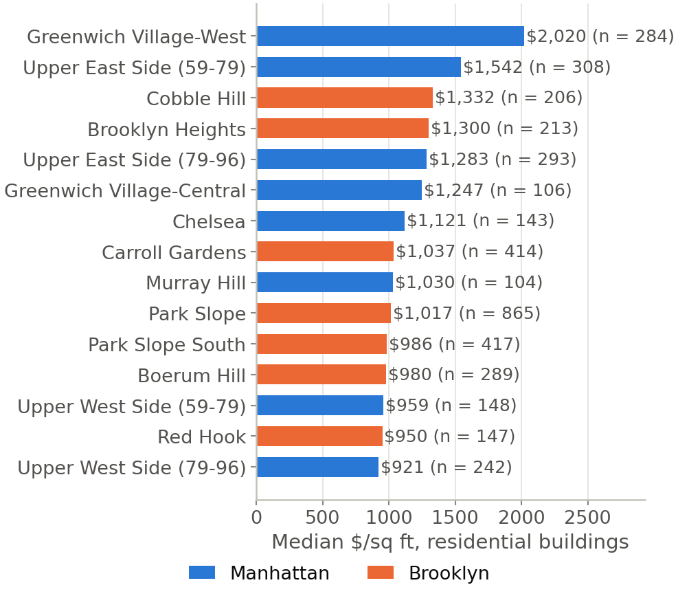

**Takeaway.** Among neighbourhoods with >= 100 residential per-sq-ft sales, Greenwich Village-West (Manhattan) is priciest at $2,020/sq ft; 8 of the top 15 are in Manhattan and 7 in Brooklyn. Neighbourhood explains far more than borough, so tests should condition on it.

## Toll zone: map and quarterly prices
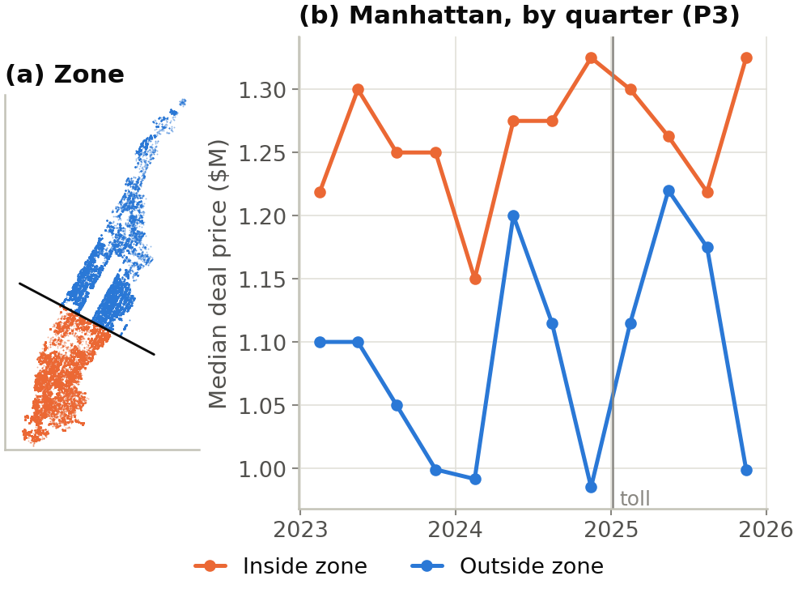

**Takeaway.** 54% of geocoded Manhattan market deals fall inside the zone. Counting each deal once, the median price inside went $1.25M -> $1.27M (+1.6%) from 2024 to 2025, outside $1.07M -> $1.15M (+6.6%). Counting every lot of multi-lot deals would instead show +10.4% inside vs +5.1% outside; the largest, one $170M deal repeated on 280 lots in 2025, weighs as 280 sales, so price statistics use one row per deal. Quarterly medians are noisy (880-1,443 deals per cell), and the condo/co-op mix differs inside and outside, so T3 compares like types.

## Market price by borough
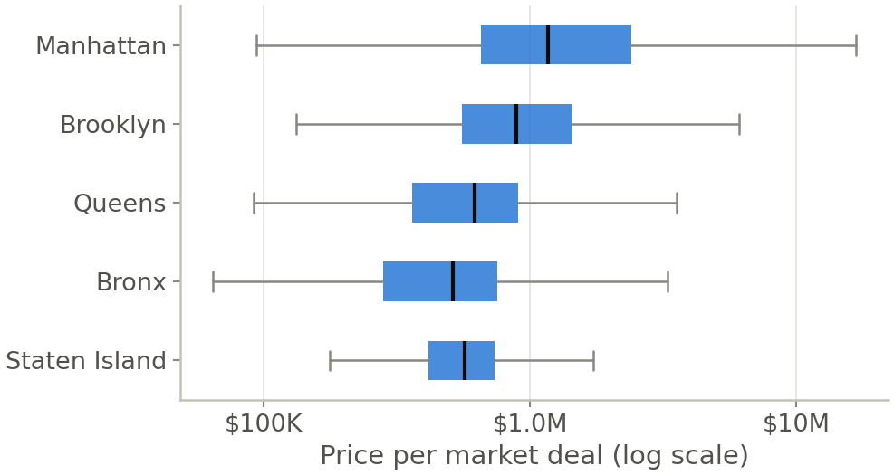

**Takeaway.** Median deal price: Manhattan $1.2M, Brooklyn $885K, Queens $620K, Bronx $514K, Staten Island $569K. The boxes overlap heavily, so borough alone is a weak summary of price.

## Correlation matrix
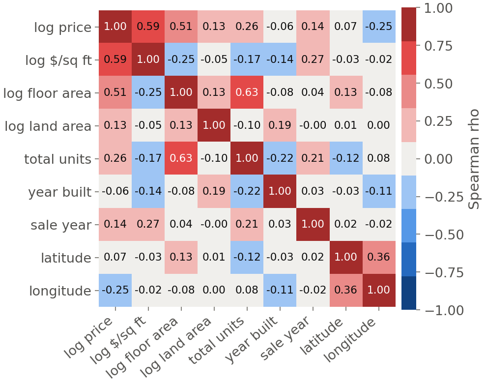

**Takeaway.** Log price rises with floor area (rho = 0.51) and units (rho = 0.26); year built vs log $/sq ft is only rho = -0.14 citywide, and latitude/longitude vs log $/sq ft are -0.03/-0.02: location matters (f09) but not in a straight line north-south, so it must enter as neighbourhood, not coordinates. Rank correlations (pairwise complete, multi-lot rows left out) because every variable is skewed; associations, not causes.
